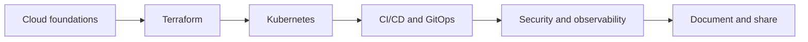

  

  

## About me

I'm a Senior DevOps Engineer focused on secure AWS infrastructure, automation and repeatable delivery. I believe the best way to learn engineering is to build it, break it, troubleshoot it and document what worked.

- **Cloud engineering:** AWS infrastructure, serverless workloads, ECS and multi-account governance.
- **Automation:** Terraform, Ansible, Python, Bash and GitHub Actions.
- **Security:** Least-privilege IAM, service control policies and secure deployment practices.
- **Current mission:** Deepen my Kubernetes, Terraform and CI/CD expertise through hands-on labs and share the lessons with the community.

## Engineering toolbox

  

| Practice | Focus |
| --- | --- |
| Cloud foundations | AWS IAM, VPC, ECS, Lambda, S3, CloudWatch |
| Infrastructure delivery | Terraform, reusable infrastructure, environment isolation |
| Automation | Ansible roles, Python, Bash, AWS CLI |
| Cloud-native learning | Kubernetes workloads, networking, GitOps |
| Delivery and operations | CI/CD, validation, troubleshooting, runbooks |

## AWS certifications

| Certification | Track |
| --- | --- |
| AWS Certified Solutions Architect – Associate | Architecture |
| AWS Certified AI Practitioner | AI fundamentals |
| AWS Certified Cloud Practitioner | Cloud foundations |

## Project showcase

| Repository | What to explore |
| --- | --- |
| [Ansible Arena](https://github.com/MeenalJy/Ansible_Arena) | Configuration automation, reusable Nginx role and local labs |
| [Docker Capabilities Demo](https://github.com/MeenalJy/docker-capabilities-demo) | Container capabilities and security experiments |
| [EC2 Web Server Lab](https://github.com/MeenalJy/ec2-ssh-httpd-website) | AWS EC2 and web server deployment |
| [90 Days of DevOps](https://github.com/MeenalJy/90DaysOfDevOps) | DevOps learning exercises |
| [IAM Admin Access Detector](https://github.com/MeenalJy/admin-access-detector) | Security reference project; original author [Ayshwarya Mohan](https://github.com/Aysh170820/admin-access-detector) |

## My cloud-native learning roadmap

My goal is a reproducible platform with infrastructure code, automated delivery, operational runbooks and practical troubleshooting examples. The roadmap represents ongoing learning, not completed production projects.

## GitHub activity

  
  

<a href="https://github.com/MeenalJy?tab=achievements">Explore my GitHub achievements</a> · <a href="https://github.com/MeenalJy">Contribution activity</a>

## My engineering journal

GitHub is my home for engineering knowledge. I am beginning a fresh chapter: learning deeply, building hands-on projects, documenting troubleshooting and sharing what I discover through repository READMEs, labs and open-source contributions.

- [Explore my repositories](https://github.com/MeenalJy?tab=repositories) for code, experiments and learning notes.
- [Follow my GitHub profile](https://github.com/MeenalJy) to follow my progress.
- Open an issue or pull request in a relevant repository to exchange ideas or collaborate.

**Learn deeply. Build practically. Share openly.**
