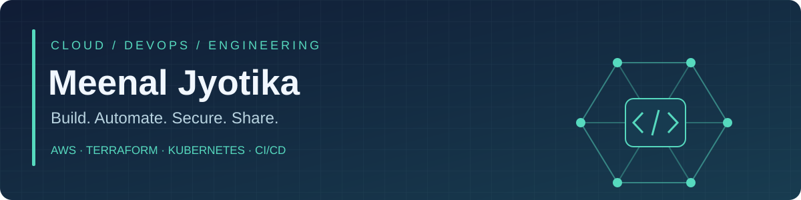
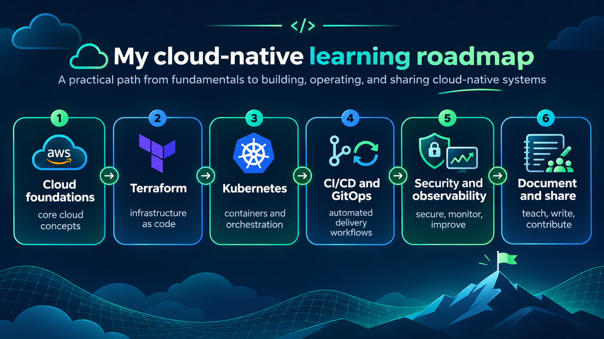

<h2 align="center">Senior Cloud & DevOps Engineer</h2>

<strong>Build with purpose. Learn with curiosity. Share with humility.</strong>

  

  
  
  

## About me

I am a Senior DevOps Engineer with a background in AWS infrastructure, automation, cloud security and reliable delivery. I am building a fresh chapter in my engineering journey: deep hands-on practice, reproducible projects and knowledge that helps other engineers.

- **Build:** Secure, scalable cloud infrastructure and reusable automation.
- **Automate:** Infrastructure as Code, CI/CD pipelines and operational workflows.
- **Learn:** Kubernetes, Terraform and GitOps from fundamentals to advanced practice.
- **Share:** Practical labs, architecture decisions, troubleshooting notes and lessons learned.

## Engineering toolbox

  

| Domain | Focus |
| --- | --- |
| Cloud engineering | AWS, VPC, IAM, ECS, Lambda, S3, CloudWatch |
| Infrastructure as Code | Terraform, reusable infrastructure and environment isolation |
| Configuration management | Ansible, Linux and repeatable automation |
| Delivery | GitHub Actions, Docker, CI/CD |
| Cloud-native learning | Kubernetes, GitOps and observability |
| Security | Least privilege, IAM governance and secure deployments |

## AWS certifications

| Certification | Focus |
| --- | --- |
| AWS Certified Solutions Architect – Associate | Cloud architecture |
| AWS Certified AI Practitioner | AI fundamentals |
| AWS Certified Cloud Practitioner | Cloud foundations |

## Project showcase

| Repository | Explore |
| --- | --- |
| [Ansible Arena](https://github.com/MeenalJy/Ansible_Arena) | Reusable Nginx role, local automation labs and validation |
| [Docker Capabilities Demo](https://github.com/MeenalJy/docker-capabilities-demo) | Container capabilities and security experiments |
| [EC2 Web Server Lab](https://github.com/MeenalJy/ec2-ssh-httpd-website) | AWS compute and web server deployment |
| [90 Days of DevOps](https://github.com/MeenalJy/90DaysOfDevOps) | DevOps learning exercises |
| [Simple-TF](https://github.com/MeenalJy/Simple-TF) | Terraform fundamentals |

## My cloud-native learning roadmap

My goal is to build an end-to-end cloud-native platform with reusable infrastructure, automated deployments, security controls and operational runbooks. This roadmap describes my learning direction, not a claim that every milestone is complete.

## Engineering journal

GitHub is my home for learning and sharing. I document the why, the how and the lessons learned behind each project.

- **Hands-on labs:** Reproduce the infrastructure and understand each component.
- **Engineering notes:** Explain architecture choices, trade-offs and troubleshooting.
- **Continuous improvement:** Make small, meaningful changes through issues and pull requests.
- **Community:** Contribute useful fixes and share practical solutions.

## GitHub activity

  
  

<a href="https://github.com/MeenalJy?tab=achievements">View my GitHub achievements</a> · <a href="https://github.com/MeenalJy">Explore my contribution activity</a>

---

<strong>One meaningful project at a time. One stronger engineer every day.</strong>

